# Gamma/Hadron Satellite Signal Classification

A PyTorch neural-network project for binary classification of Cherenkov telescope observations from the MAGIC Gamma Telescope dataset. The notebook trains a fully connected network to distinguish **gamma** (`g`) and **hadron** (`h`) shower events using ten physical numerical features.

**Notebook:** [`Dataset/base-ml-model.ipynb`](Dataset/base-ml-model.ipynb)  
**Dataset:** [`Dataset/Dataset.csv`](Dataset/Dataset.csv)  

## Project Summary

| Item | Value |
|---|---|
| Task | Binary tabular classification |
| Positive/negative labels | `g` = gamma, `h` = hadron |
| Encoded classes | `g` → `0`, `h` → `1` |
| Total records | 19,020 |
| Input features | 10 |
| Training records | 15,216 |
| Test records | 3,804 |
| Train/test split | 80% / 20%, `random_state=42` |
| Neural network | 10 → 64 → 32 → 2 |
| Framework | PyTorch |
| Optimizer | Adam |
| Learning rate | `0.001` |
| Loss function | CrossEntropyLoss |
| Batch size | 100 |
| Epochs | 100 |
| Recorded test accuracy | **87.67%** |
| Saved model | No model checkpoint is written by the notebook |

## Results

The saved notebook output reports a final training loss of **0.2535**, training accuracy of **89.59%**, and test accuracy of **87.67%** after epoch 100. The training run executed on CPU, as represented by the notebook output: `device(type='cpu')`.

| Metric | Recorded value |
|---|---:|
| Final epoch | 100 |
| Final training loss | 0.2535 |
| Final training accuracy | 89.59% |
| Correct training predictions | approximately 13,632 of 15,216 |
| Recorded test accuracy | 87.67% |
| Correct test predictions | approximately 3,335 of 3,804 |

Approximate correct-prediction counts are derived from accuracy and should be treated as estimates, because the notebook does not persist the confusion matrix or per-example predictions.

### Class distribution

| Class | Encoded label | Records | Share |
|---|---:|---:|---:|
| Gamma (`g`) | 0 | 12,332 | 64.84% |
| Hadron (`h`) | 1 | 6,688 | 35.16% |
| **Total** | — | **19,020** | **100.00%** |

The dataset has moderate class imbalance. Accuracy alone does not show whether gamma and hadron classes are predicted equally well. Precision, recall, F1-score, specificity, confusion matrix, ROC-AUC, and class-balanced metrics should be collected before production evaluation.

## Architecture Diagram

```mermaid
flowchart LR
    Dataset[(Dataset.csv\n19,020 rows × 11 columns)]
    Split[Train/test split\n80% / 20%]
    Encoder[LabelEncoder\ng→0, h→1]
    Scale[StandardScaler\nfit on training data]
    DatasetLoader[Custom PyTorch Dataset\nDataLoader, batch size 100]
    Input[10 standardized features]
    Hidden1[Linear 10 → 64\nReLU]
    Hidden2[Linear 64 → 32\nReLU]
    Output[Linear 32 → 2 logits]
    Loss[CrossEntropyLoss]
    Adam[Adam optimizer\nlearning rate 0.001]
    Trained[Trained model]
    Evaluation[Test inference\nno gradient]
    Metrics[Accuracy and future metrics]

    Dataset --> Encoder --> Split --> Scale --> DatasetLoader --> Input
    Input --> Hidden1 --> Hidden2 --> Output
    Output --> Loss
    Loss --> Adam --> Trained --> Evaluation --> Metrics
```



## Neural Network Design

```text
Input:  10 features
        ↓
Linear: 10 → 64
        ↓
ReLU
        ↓
Linear: 64 → 32
        ↓
ReLU
        ↓
Linear: 32 → 2
        ↓
Class logits
```

The highest logit is selected with `argmax(dim=1)` for each sample.

## Dataset Description

The `Dataset.csv` file contains ten numerical observation features and one categorical target. The notebook reports 19,020 rows, 11 columns, no missing values, ten `float64` feature columns, and one object target column before encoding.

| Feature | Description | Type |
|---|---|---|
| `fLength` | Major axis length of the ellipse fitted to the shower image | Numeric |
| `fWidth` | Minor axis length of the ellipse fitted to the shower image | Numeric |
| `fSize` | Total sum of pixels after cleaning, related to shower brightness | Numeric |
| `fConc` | Concentration of light in the two brightest pixels | Numeric |
| `fConc1` | Alternative concentration measure using the brightest pixel | Numeric |
| `fAsym` | Asymmetry of the shower image along its main axis | Numeric |
| `fM3Long` | Third statistical moment along the major axis | Numeric |
| `fM3Trans` | Third statistical moment along the minor axis | Numeric |
| `fAlpha` | Angle between shower axis and source position | Numeric |
| `fDist` | Distance from the image center of gravity to the camera center | Numeric |
| `class` | Original target: `g` (gamma) or `h` (hadron) | Categorical |

Descriptions are conventional interpretations of MAGIC telescope Hillas parameters. Confirm domain-specific definitions in the original MAGIC dataset documentation before publishing the model or report for scientific use.

## Machine Learning Pipeline

### 1. Reproducibility setup

The notebook sets `torch.manual_seed(42)` and passes `random_state=42` to the train/test split. The device is selected automatically with CUDA when available; the executed notebook used CPU.

### 2. Label encoding

```python
Label = LabelEncoder()
df['class'] = Label.fit_transform(df['class'])
```

For this dataset and sorted string labels, LabelEncoder assigns:

```text
g -> 0
h -> 1
```

### 3. Feature selection

The model uses only the ten `f*` columns listed above. The original class column is excluded from the feature matrix.

### 4. Dataset split

```python
train_test_split(x, y, test_size=0.2, random_state=42)
```

The result is:

- Training features: `(15216, 10)`
- Test features: `(3804, 10)`
- Training labels: `15216`
- Test labels: `3804`

### 5. Feature standardization

The notebook fits a `StandardScaler` on the training partition and applies it to both partitions.

Important implementation detail: the notebook calls `fit_transform()` on the test features rather than `transform()`. The test data should therefore be scaled using the training statistics from the fitted scaler:

```python
x_test = scaler.transform(x_test)
```

Using `fit_transform()` on test data incorrectly learns separate distribution parameters from the evaluation data and can leak test-set information into preprocessing.

### 6. PyTorch datasets and loaders

Features are converted to `float32` tensors and labels to `int64` tensors. Training uses a shuffled loader; evaluation uses an ordered loader with no shuffle.

```python
batch_size = 100
```

The final training-loader batch count is approximately 153, while the test-loader has 39 batches with a possible partial final batch.

### 7. Training loop

Each epoch:

1. Sets the model to training mode.
2. Loads a batch of 100 samples.
3. Moves features and labels to the selected device.
4. Clears gradients with `optimizer.zero_grad()`.
5. Runs a forward pass.
6. Calculates cross entropy.
7. Backpropagates gradients.
8. Updates parameters with Adam.
9. Calculates weighted epoch loss and training accuracy.

### 8. Evaluation

The model switches to evaluation mode and disables gradient calculation. Predictions are produced with `argmax`; accuracy is the proportion of correct predictions in the test set.

## Training History

The notebook output demonstrates a consistent reduction in training loss and improvement over the 100 epochs:

| Epoch | Loss | Training accuracy |
|---|---:|---:|
| 1 | 0.4803 | 77.24% |
| 10 | 0.3118 | 87.03% |
| 20 | 0.3000 | 87.55% |
| 50 | 0.2763 | 88.86% |
| 75 | 0.2709 | 88.96% |
| 90 | 0.2594 | 89.34% |
| 100 | 0.2535 | 89.59% |
| **Test final** | — | **87.67%** |

The training notebook does not output train-versus-validation curves or calculate a validation split, so the records cannot establish convergence, overfitting, or epoch selection with statistical confidence. The complete epoch history is stored in the notebook's execution output.

## Metrics and Evaluation Plan

The notebook currently computes only test accuracy. A complete evaluation should report these metrics:

### Core classification metrics

\[
\text{Accuracy}=\frac{TP+TN}{TP+TN+FP+FN}
\]

\[
\text{Precision}=\frac{TP}{TP+FP}
\]

\[
\text{Recall}=\frac{TP}{TP+FN}
\]

\[
\text{F1}=2\times\frac{Precision\times Recall}{Precision+Recall}
\]

Additional recommended measurements:

- Macro-precision, macro-recall, and macro-F1.
- Weighted precision, weighted recall, and weighted-F1.
- Gamma-class precision/recall/F1 (`g`, encoded 0).
- Hadron-class precision/recall/F1 (`h`, encoded 1).
- ROC-AUC using positive-class probabilities.
- Precision-recall AUC for the imbalanced class mix.
- Confusion matrix: true gamma, false hadron, false gamma, and true hadron.
- Cohen's kappa and Matthews correlation coefficient.
- Per-class support and confidence intervals.

### Suggested evaluation code

```python
from sklearn.metrics import (
    accuracy_score,
    classification_report,
    confusion_matrix,
    f1_score,
    precision_recall_fscore_support,
    roc_auc_score,
)

model.eval()
y_true = []
y_pred = []
y_score = []

with torch.no_grad():
    for features, labels in test_loader:
        features = features.to(device)
        logits = model(features)
        probabilities = torch.softmax(logits, dim=1)
        predictions = logits.argmax(dim=1)

        y_true.extend(labels.cpu().tolist())
        y_pred.extend(predictions.cpu().tolist())
        y_score.extend(probabilities[:, 1].cpu().tolist())

print(confusion_matrix(y_true, y_pred))
print(classification_report(y_true, y_pred, target_names=['gamma', 'hadron']))
print('Accuracy:', accuracy_score(y_true, y_pred))
print('Macro F1:', f1_score(y_true, y_pred, average='macro'))
print('ROC-AUC:', roc_auc_score(y_true, y_score))
print('Precision/recall/F1/support:', precision_recall_fscore_support(y_true, y_pred))
```

## Repository Structure

```text
Satellite Project/
├── README.md
└── Dataset/
    ├── base-ml-model.ipynb
    └── Dataset.csv
```

## Setup and Execution

### Prerequisites

- Python 3.8+
- pandas
- NumPy
- matplotlib
- seaborn
- PyTorch
- scikit-learn
- Jupyter Notebook or JupyterLab

### Install dependencies

```bash
python -m pip install pandas numpy matplotlib seaborn torch scikit-learn jupyter
```

### Run the notebook

```bash
jupyter notebook "Dataset/base-ml-model.ipynb"
```

Before running, update the absolute CSV path in the notebook:

```python
df = pd.read_csv("Dataset.csv")
```

When the notebook is run from the `Satellite Project/Dataset` directory, the relative filename above is sufficient.

## Notebook Improvements

### Data correctness

- Replace `df.dropna()` with `df = df.dropna()` if missing rows are expected to be removed.
- Set `x_test = scaler.transform(x_test)` to prevent test-set preprocessing leakage.
- Use `stratify=y` during train/test splitting to preserve the class ratio.
- Add a validation split instead of reporting training and test metrics only.

### Reproducibility

- Seed NumPy and Python random generators as well as PyTorch.
- Configure deterministic CUDA operations when GPU training is enabled.
- Avoid reusing notebooks with author-specific absolute paths.
- Save hyperparameters and dataset version beside generated results.

### Training quality

- Add learning-rate scheduling and optional weight decay.
- Monitor validation loss and apply early stopping.
- Record epoch, loss, accuracy, and wall time in structured logs.
- Add class-weighted cross entropy if operating costs differ by class.
- Compare against logistic regression, random forest, or gradient boosting baselines.

### Evaluation

- Add confusion matrix, precision, recall, F1, ROC-AUC, and PR-AUC.
- Report uncertainty with repeated folds or bootstrap confidence intervals.
- Compare results across class-balanced and stratified splits.
- Plot calibration curves and reliability diagrams.
- Verify model calibration if probabilities will drive decisions.

### Deployment

- Persist feature names and fitted scaler parameters with the model.
- Save the `state_dict` and class mapping.
- Add input schema validation and range checks.
- Export to ONNX if cross-platform inference is required.
- Add inference tests and model/version metadata.

## Production Limitations

1. The notebook is an experimental baseline, not a deployable service.
2. The test scaler has a possible information-leakage bug.
3. No model checkpoint is generated.
4. No serialization includes feature order or class names.
5. No validation data, cross-validation, or uncertainty estimate is used.
6. No confusion matrix or per-class metrics are recorded.
7. The notebook uses an absolute input path from a local development machine.
8. Accuracy is insufficient because gamma/hadron populations differ in frequency and cost.
9. No data drift, calibration, or inference monitoring is implemented.
10. Training behavior on GPU is not guaranteed to match the recorded CPU run exactly.

## License and Data Attribution

Review the licensing and citation requirements of the MAGIC Gamma Telescope dataset and this repository before redistribution or publication. The notebook should include the original source citation and license terms where required.
